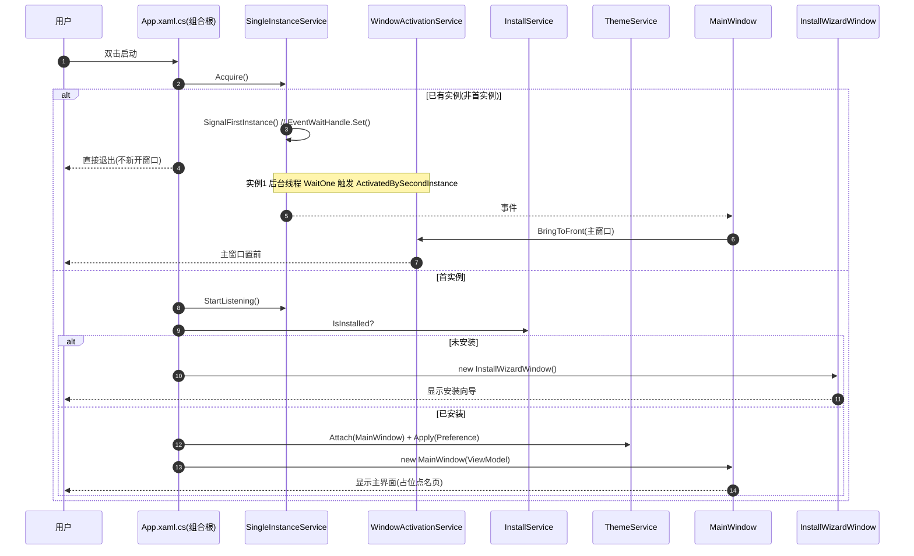
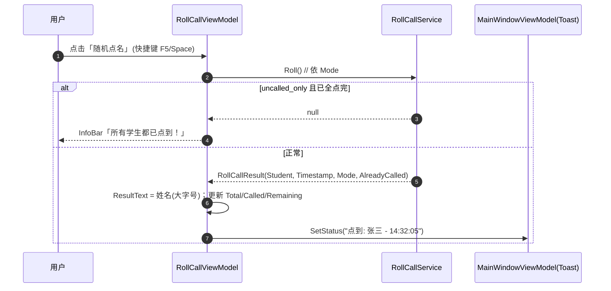
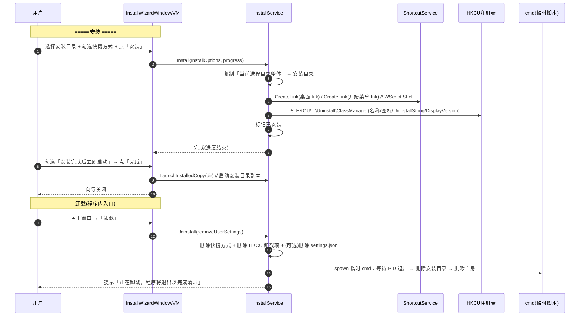
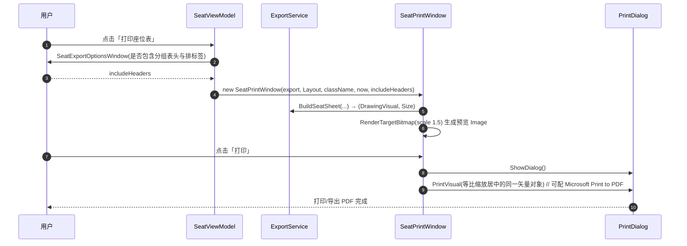

# 班级综合管理系统（C# WPF-UI 重构版）· 系统架构设计与任务分解

> 文档版本：v1.2（同步「死键移除 + 导出签名收敛」源码变更，见 §0.3）
> 撰写：系统架构师 高见远
> 输入：`docs/PRD.md`（产品经理 许清楚）、原始实现 `D:/信息技术/班级管理系统.py`（1904 行 Tkinter）
> 目标读者：开发工程师、测试工程师
> 语言：简体中文
> 本设计**已在本机实测还原并 `dotnet build -c Release` 通过**（0 警告 0 错误），所有包版本与 API 名称均为实测结果，工程师可直接照抄。

---

## 0. 实测环境与结论摘要

| 项 | 实测值 |
|---|---|
| .NET SDK | `8.0.421` |
| 目标框架 | `net8.0-windows`（`Microsoft.WindowsDesktop.App 8.0.27`） |
| 发布 RID | `win-x64` |
| 自包含发布产物 | **260 个文件 / ≈168 MB**（含完整 .NET 运行时 + WPF 原生库），`PublishSingleFile=false` 时为文件夹形态 |
| 最小验证工程 | `ClassManager.App`（WinExe, WPF）+ `ClassManager.Tests`（xUnit, 引用 App）→ **编译 0 警告 0 错误；`dotnet test` 1/1 通过** |

### 0.1 实测验证过的命令结果（关键输出行）

```
> dotnet build ClassManager.sln -c Release
  Probe.App  -> ...\net8.0-windows\Probe.App.dll
  Probe.Tests -> ...\net8.0-windows\Probe.Tests.dll
已成功生成。 0 个警告 0 个错误

> dotnet test ClassManager.sln -c Release
已通过! - 失败: 0，通过: 1，已跳过: 0，总计: 1

> dotnet publish ... -c Release -r win-x64 --self-contained true -p:PublishSingleFile=false
  Probe.App -> ...\publish\
文件数: 260   总大小: 168M
```

### 0.2 实测踩到的 5 个"坑"（务必照本设计规避）

| # | 现象 | 真相 | 正确写法 |
|---|---|---|---|
| 1 | `NavigationView` 内直接写 `<StackPanel>` 报 `MC3028 无法添加内容`；写 `<ui:NavigationView.Content>` 报 `MC3074 标记不存在` | **WPF-UI 4.x 的 `NavigationView` 不是 ContentControl**，内容由内部只读的 `NavigationViewContentPresenter` 承载 | 内容一律做成 `Page`，用 `NavigationViewItem.TargetPageType="{x:Type ...}"` + `INavigationViewPageProvider` 导航 |
| 2 | `MiniExcel.Query<Row>(path, useHeaderRow: true)` 报 `CS1739 无此命名参数`；传 `bool` 报 `CS1503 无法从 bool 转 string` | **泛型 `Query<T>` 没有 `useHeaderRow` 参数**（首行即表头，按属性名映射）；第二参数是 `string sheetName` | 泛型：`Query<T>(path)` / `Query<T>(path, sheetName)`；需要 `useHeaderRow` 时用**非泛型** `Query(path, useHeaderRow: true)` |
| 3 | `SnackbarPresenter.Show(...)` 报 `CS1061 不包含 Show` | `Show` 在 `ISnackbarService`/`Snackbar` 上，`Presenter` 只是宿主 | `new SnackbarService()` → `SetSnackbarPresenter(presenter)` → `Show(title,msg,appearance,icon,timeout)` |
| 4 | `ApplicationTheme sys = SystemThemeManager.GetCachedSystemTheme()` 报 `CS0266` | 该方法返回 **`Wpf.Ui.Appearance.SystemTheme`**，与 `ApplicationTheme` 是两个枚举 | 用 `SystemTheme` 类型接收 |
| 5 | 测试工程引用 App 报"目标框架不兼容" | 测试工程必须同为 **`net8.0-windows`**（不能是 `net8.0`） | `<TargetFramework>net8.0-windows</TargetFramework>` + `<UseWPF>true</UseWPF>` |

### 0.3 本轮变更（v1.1）：座位管理画布极简重做

> 用户新要求「画布太难看，要简洁风，用矩形代替座位；行/列数及行间距/列间距可设置；讲台黑框白底黑字，不要黑板；画布太大要可滑动；方格上只保留学生姓名、分数一概不要」；另拍板：讲台在**底部**、分组表头与排标签保留但**导出/打印时可选择是否包含**、界面**蓝白搭配、蓝色强化**、导出图片/PDF **白底只有黑色方格**。
> 下表与本文档相应章节均已**依据 `ClassManager.App` 实际源码**核对。

| 变更 | 内容 |
|---|---|
| 画布风格 | 废弃原「课桌+椅子+过道+黑板+主题调色板」方案；改为**极简矩形**：座位 = 单个矩形，方格内**只显示学生姓名**（无分数），空座位上**不显示任何文字**（原「空座位」文案取消），长姓名自动折行 |
| 配色 | 画布固定**蓝白**（`SeatMapPalette`，**不随明暗主题**）：空座 `#FFFFFF`+边框 `#9CC3E5`；已排座 `#D6E9FA`；选中 `#CFE4F7`+边框 `#0078D4`；画布底 `#FFFFFF`；排标签/分组表头 `#4A6B85`；讲台 `#FFFFFF`+边框 `#000000`+黑字。导出/打印为**白底黑格** |
| 讲台 | 位于网格**底部**、水平居中，高 **56**、与第一排底边间隔 **40**；**无黑板、无中列过道** |
| 行序 | **row 0（第一排）渲染在最下方、紧邻讲台**，第 N 排在**最上方** |
| 校验范围 | 行 **1–20**、列 **1–20**（原 3–12 / 4–10）；非法提示 `行数必须在1-20之间，列数必须在1-20之间` |
| 新增能力 | ① 逐道**行/列间距**可调（统一填充 + 逐道编辑 + 分组阈值）→ `Views/GapSettingsWindow.xaml`；② 导出/打印时**可选是否包含分组表头与排标签** → `Views/SeatExportOptionsWindow.xaml`；③ 画布**双向滚动**（滚轮=垂直、`Shift`+滚轮=水平、中键拖动平移） |
| 分组表头 | 按「列间隙 ≥ `GroupThreshold`」把列切成若干块，逐块标 `第一组`/`第二组`…；切不出 ≥2 块时只显示 `第一组` |
| 打印 | 改为 `PrintDialog.PrintVisual` **矢量打印**（可配 Microsoft Print to PDF），预览与打印复用同一矢量对象 |
| 能力移除 | **原「另存为 .txt」文本导出已移除**（`IExportService.BuildPrintText` 删除）——属**能力变更**，已上报用户确认 |
| 配色键（已落地移除） | 画布改写后**全仓零引用**的 **10 个死键已从 `Themes/Palette.xaml` 与 `ThemeService.PaletteMap` 移除**：`DeskBrush`、`DeskLegBrush`、`ChairBrush`、`AisleBrush`、`PlatformBrush`、`BlackboardBrush`、`SeatEmptyBrush`、`SeatOccupiedBrush`、`CalledBrush`、`UncalledBrush`。**仅保留** `SeatSelectedBrush`（`Views/SeatPage.xaml` 学生按钮选中态）与 `SeatedChipBrush`（`BoolToSeatedBrushConverter` 已排座底色） |
| 画布白底单源 | `Controls/SeatMapControl.xaml` 原两处硬编码 `#FFFFFF` 已消除：构造函数中由 `SeatMapPalette.CanvasBackground` 赋值给 `Paper`(Border) 与 `Surface`(Canvas)，`CanvasBackground` 不再是死常量 |
| 导出签名（最终） | `ExportSeatXlsx` **已移除 `scores` 参数**；`BuildSeatSheet` / `ExportSeatImage` 含 `includeHeaders`。xlsx「座位表」sheet 单元格**只写学生姓名**（空座留空，不再写「空」）；「统计信息」sheet 六字段不变 |
| 死方法清理 | `AppServices.BuildScoreMap()` 已删除（其唯一调用点是被移除的 xlsx `scores` 实参） |

---

## 1. 实现方案与框架选型

### 1.1 核心难点与技术对策

| 难点 | 对策 |
|---|---|
| 座位表需矢量绘制（极简矩形座位 + 底部讲台 + 分组表头/排标签）+ 命中点击 + 双向滚动/中键平移 | 自绘 `SeatMapControl`（`ScrollViewer` + `Canvas` 命中测试）；坐标与尺寸由 `SeatMapGeometry` 统一计算，**画布与导出共用同一套几何**，确保所见即所得 |
| 座位表导出 PNG / 打印需高清且不依赖外部字体 | `ExportService.BuildSeatSheet` 生成**白底黑格**矢量 `DrawingVisual`；导出用 `RenderTargetBitmap` 96 DPI × **2 倍缩放**，打印直接 `PrintDialog.PrintVisual` 同一矢量对象 |
| Excel 读写需轻量 | **MiniExcel**（流式、无 COM、无 EPPlus/ClosedXML 依赖）；不支持旧版二进制 `.xls`（见 §2.4） |
| 单实例且重复启动要**激活已有窗口** | 命名 `Mutex`（唯一性）+ 命名 `EventWaitHandle`（跨进程信号）；实例 2 阻塞式 `Set()` 后退出，实例 1 后台线程等待事件 → `Dispatcher.Invoke` 激活主窗口 |
| 自包含安装向导 + 程序内卸载 + 自删除 | 复制"当前进程所在文件夹整体"到安装目录；`WScript.Shell` COM 晚绑定建快捷方式；`HKCU` 卸载项；卸载末尾 **spawn 临时 cmd 延迟脚本**在本进程退出后删除安装目录 |
| 跟随系统明暗主题 | `SystemThemeWatcher.Watch(window, backdrop, true)` + `ApplicationThemeManager.Changed` 事件 |

### 1.2 技术栈与架构模式（固定，不推翻）

| 层 | 选型 |
|---|---|
| 语言 / 框架 | C# 12 / **.NET 8** / **WPF**（`net8.0-windows`, `UseWPF=true`） |
| UI 控件库 | **WPF-UI 4.3.0**（lepo.co，Fluent 控件） |
| MVVM | **CommunityToolkit.Mvvm 8.4.2**（`ObservableObject` / `[ObservableProperty]` / `[RelayCommand]`） |
| Excel/CSV | **MiniExcel 1.46.0** |
| 测试 | **xUnit**（`Microsoft.NET.Test.Sdk 17.11.1` + `xunit 2.9.2` + `xunit.runner.visualstudio 2.8.2`） |
| 架构模式 | **MVVM + 分层**（Models / Services / ViewModels / Views / Controls / Converters / Themes / Assets）；**手工组合根**（无 MS DI 容器，`AppServices` 静态装配），避免额外重依赖 |
| 持久化 | `%AppData%\ClassManager\settings.json`（System.Text.Json，BCL 内置） |
| 部署 | 自包含文件夹 + 首次运行安装向导（`asInvoker` 免 UAC） |

> **明确取舍**：不引入数据库、不引入 Newtonsoft.Json、不引入 EPPlus/ClosedXML、不引入图形库、不引入 MS DI 容器。所有 JSON 用 `System.Text.Json`，所有 Excel 用 MiniExcel，所有绘图用 WPF 原生。

### 1.3 已拍板决策的落地方式（对齐交付总监指令）

| 决策 | 落地 |
|---|---|
| 2 个工程 | `ClassManager.App`（WinExe，含全部 UI/VM/Service/Model）+ `ClassManager.Tests`（xUnit，引用 App） |
| 主容器 | `FluentWindow` + `NavigationView`（侧边导航，两页）+ `Mica` 背景 |
| 主题 | 默认跟随系统；可手动 Light/Dark 覆盖；持久化到 settings.json |
| 安装向导 | 首次运行（未安装）弹 WPF-UI 向导；复制当前目录 → 快捷方式 → HKCU 卸载项 → 启动副本 |
| 单实例 | 命名 Mutex + 命名 EventWaitHandle（**单一方案**，见 §7.6） |
| 自删除卸载 | cmd 延迟脚本（**单一方案**，见 §7.7） |
| 随机演示成绩 | 设置项 `GenerateDemoScores`，默认 `true`（对齐原行为） |
| `.xls` 能力差异 | 文件对话框仅筛 `csv/xlsx`；选到 `.xls` 给明确可读提示（见 §7.8） |
| 死代码"编辑作者信息" | 保留，作为「关于」窗口的次级入口 `AuthorInfoWindow` |
| 座位画布 | 极简矩形 + 固定**蓝白**配色（`SeatMapPalette`）；讲台在**底部**；**方格仅显示姓名**（无分数）、空座无文字；行/列 **1–20** 可调 |
| 行/列间距 | 逐道可调（`SeatLayout.ColumnGaps`/`RowGaps` + `GroupThreshold`）→「间距设置」窗口 |
| 分组表头/排标签 | 保留，但导出/打印时**可选是否包含**（`SeatExportOptionsWindow`） |
| 导出/打印风 | **白底黑格**；打印改**矢量**（`PrintDialog.PrintVisual`）；**移除 `.txt` 文本导出**（能力变更，已上报用户确认） |

---

## 2. 依赖与 API 契约（实测清单，工程师照抄）

### 2.1 NuGet 包（精确版本，已还原验证）

```xml
<!-- ClassManager.App -->
<PackageReference Include="WPF-UI" Version="4.3.0" />                 <!-- 含 Wpf.Ui + Wpf.Ui.Abstractions -->
<PackageReference Include="CommunityToolkit.Mvvm" Version="8.4.2" />
<PackageReference Include="MiniExcel" Version="1.46.0" />

<!-- ClassManager.Tests -->
<PackageReference Include="Microsoft.NET.Test.Sdk" Version="17.11.1" />
<PackageReference Include="xunit" Version="2.9.2" />
<PackageReference Include="xunit.runner.visualstudio" Version="2.8.2" />
```

> 注意：`WPF-UI` 的包 ID 是 **`WPF-UI`**（`dotnet add package WPF-UI`），程序集是 **`Wpf.Ui.dll`**。

### 2.2 XAML 命名空间与资源字典（实测可用）

```xml
xmlns:ui="http://schemas.lepo.co/wpfui/2022/xaml"
```

```xml
<!-- App.xaml：必须先 ThemesDictionary 再 ControlsDictionary -->
<Application.Resources>
  <ResourceDictionary>
    <ResourceDictionary.MergedDictionaries>
      <ui:ThemesDictionary Theme="Dark" />   <!-- 可为 Dark/Light；运行时用 ApplicationThemeManager 切换 -->
      <ui:ControlsDictionary />
    </ResourceDictionary.MergedDictionaries>
  </ResourceDictionary>
</Application.Resources>
```

### 2.3 WPF-UI 4.3.0 关键类型 / API（全部编译验证过）

**命名空间：`Wpf.Ui.Controls`**

| 类型 | 关键成员（实测） |
|---|---|
| `FluentWindow` : `Window` | 属性 `WindowBackdropType`、`WindowCornerPreference`、`ExtendsContentIntoTitleBar` |
| `WindowBackdropType`（enum） | `None` / `Mica` / `Acrylic` / `Tabbed` / `Auto` |
| `WindowCornerPreference`（enum） | `Default` / `Round` / `DoNotRound`（如用） |
| `TitleBar` : `Control` | `Title`、`Icon`(IconElement)、`Header`、`TrailingContent`、`ShowMinimize/ShowMaximize/ShowClose` |
| `NavigationView` : `Control` | **属性** `MenuItems`、`FooterMenuItems`、`PaneDisplayMode`、`SelectedItem`；**方法** `Navigate(Type, object?)`、`SetPageProviderService(INavigationViewPageProvider)`、`SetServiceProvider(IServiceProvider)`；**事件** `SelectionChanged`/`ItemInvoked`/`Navigated`。**无 `Content`** |
| `NavigationViewItem` : `Control` | `Content`、`Icon`(IconElement)、`TargetPageType`(Type)、`TargetPageTag`、`MenuItems` |
| `NavigationViewPaneDisplayMode`（enum） | `Left` / `Top` / `LeftCompact` / `LeftMinimal` / `Auto` |
| `SymbolIcon` : `IconElement` | `Symbol`(`SymbolRegular`)、`FontSize` |
| `SymbolRegular`（enum） | 例：`People24`、`Grid24`、`Search24`、`BookOpen24`、`Add24`、`Delete24`、`Settings24`、`ArrowSync24`、`Save24`、`Print24`、`Image24`、`Info24`、`DarkTheme24`、`WeatherSunny24`、`WeatherMoon24`、`Dismiss24`、`Home24` |
| `CardControl` | `Header`、`Icon`(IconElement)、`Content` |
| `Card` : `ContentControl` | — |
| `NumberBox` | `Value`(double)、`Min`、`Max`、`SmallChange`、`SpinButtonPlacementMode`、`ValidationMode`、事件 `ValueChanged`（`NumberBoxValueChangedEventArgs`） |
| `InfoBar` | `Title`、`Message`、`IsOpen`、`Severity`、`IsClosable` |
| `InfoBarSeverity`（enum） | `Informational` / `Success` / `Warning` / `Error` |
| `ControlAppearance`（enum） | `Primary` / `Secondary` / `Info` / `Success` / `Caution` / `Danger` / `Dark` / `Light` / `Transparent` |
| `SnackbarPresenter` : `ContentControl` | 仅作宿主（**无 Show**） |
| `Snackbar` | `Title`、`Content`、`Appearance`、`Timeout`、`Show()`、`ShowAsync()` |
| `MessageBox` : `ContentDialog` | `Title`、`Content`、`PrimaryButtonText`、`SecondaryButtonText`、`CloseButtonText`、`IsPrimaryButtonEnabled`…；`ShowDialogAsync(bool, CancellationToken)` → `MessageBoxResult` |
| `ContentDialog` | `ShowAsync(CancellationToken)`；**需要宿主**（`ContentDialogHost.GetForWindow(window)` / `DialogHost`）——本项目**不用**，统一用 `MessageBox` + 自定义 `FluentWindow` |
| `TextBlock` | `Text`、`FontTypography`（`Body` / `BodyStrong` / `Subtitle` / `Title` / `Caption`…） |
| `Button` | `Content`、`Appearance`(ControlAppearance)、`Icon`(IconElement) |

**命名空间：`Wpf.Ui`**

| 类型 | 关键成员 |
|---|---|
| `ISnackbarService` | `Show(string title, string message, ControlAppearance appearance, IconElement? icon, TimeSpan timeout)`、`SetSnackbarPresenter(SnackbarPresenter)`、`GetSnackbarPresenter()`、`DefaultTimeOut` |
| `SnackbarService` : `ISnackbarService` | 同上（可直接 `new`，无需 DI） |

**命名空间：`Wpf.Ui.Appearance`**

| 类型 | 关键成员 |
|---|---|
| `ApplicationThemeManager`（静态） | `Apply(ApplicationTheme applicationTheme, WindowBackdropType backgroundEffect, bool updateAccent)`、`Apply(FrameworkElement)`、`GetAppTheme()`→`ApplicationTheme`、`GetSystemTheme()`、`IsMatchedDark()`、`IsMatchedLight()`、`IsSystemHighContrast()`、事件 `Changed` |
| `ApplicationTheme`（enum） | `Unknown` / `Light` / `Dark` / `HighContrast` |
| `SystemThemeManager`（静态） | `GetCachedSystemTheme()`→**`SystemTheme`**、`UpdateSystemThemeCache()`、`GlassColor`、`HighContrast` |
| `SystemTheme`（enum） | `Unknown` / `Light` / `Dark` / `HC` / `HCBlack` / `HCWhite` / `Custom` … |
| `SystemThemeWatcher`（静态） | `Watch(Window, WindowBackdropType, bool)`、`UnWatch(Window)` |

**命名空间：`Wpf.Ui.Abstractions`**（由 `WPF-UI` 传递引用）

| 类型 | 成员 |
|---|---|
| `INavigationViewPageProvider` | `object? GetPage(Type pageType)` |

### 2.4 MiniExcel 1.46.0 API 与能力边界（实测）

命名空间：`MiniExcelLibs`（静态类 `MiniExcel`、枚举 `ExcelType`）

| 用途 | 实测通过的调用 |
|---|---|
| 强类型读（按属性名映射） | `MiniExcel.Query<T>(string path)` |
| 强类型读指定 sheet | `MiniExcel.Query<T>(string path, string sheetName)` |
| 动态读（列名自动识别） | `MiniExcel.Query(string path, useHeaderRow: true)` → `IEnumerable<dynamic>` |
| 单表写出 | `MiniExcel.SaveAs(path, rows, printHeader: true, excelType: ExcelType.XLSX)` |
| **多 Sheet 写出** | `MiniExcel.SaveAs(path, new Dictionary<string, object>{ {"座位表", seats}, {"统计信息", info} }, printHeader: true, excelType: ExcelType.XLSX)` |
| 取 sheet 名 | `MiniExcel.GetSheetNames(path)` → `List<string>` |
| `ExcelType` 枚举 | `XLSX` / `CSV` / `UNKNOWN` |

> ⚠️ **能力差异（显式记录）**：MiniExcel **只支持 `.csv` 与 `.xlsx`**，**不支持旧版二进制 `.xls`**（BIFF）。因此：
> 1. 文件选择对话框过滤器仅含 `Excel(.xlsx)` + `CSV(.csv)`，**不再出现 `.xls`**；
> 2. 兜底：若用户通过"所有文件"或手工输入路径选中 `.xls`，`ImportService` 需检测扩展名并抛出可读异常，UI 提示：**"暂不支持旧版 .xls（二进制）文件，请用 Excel 另存为 .xlsx 或 .csv 后重试。"**（不进入 MiniExcel 解析）。

---

## 3. 项目结构与完整文件清单

### 3.1 解决方案布局

```
D:/信息技术/ClassManager/
├── ClassManager.sln                     # 解决方案（2 工程）
├── docs/
│   ├── PRD.md
│   ├── ARCHITECTURE.md                  # 本文档
│   ├── class-diagram.mermaid
│   └── sequence-diagram.mermaid
├── ClassManager.App/                    # WinExe, net8.0-windows, UseWPF
└── ClassManager.Tests/                  # xUnit, net8.0-windows, 引用 App
```

`ClassManager.App` 内部分层：`Assets / Models / Services / ViewModels / Views / Controls / Converters / Themes`。

### 3.2 完整文件清单（相对 `D:/信息技术/ClassManager/`）

| # | 相对路径 | 职责（一句话） | 预估行数 |
|---|---|---|---|
| 1 | `ClassManager.sln` | 解决方案，聚合 App 与 Tests 两个工程 | ~30 |
| 2 | `ClassManager.App/ClassManager.App.csproj` | 主工程：WinExe / net8.0-windows / UseWPF / ApplicationIcon / 包引用（§2.1） | ~40 |
| 3 | `ClassManager.App/app.manifest` | 清单：`asInvoker`（免 UAC）+ PerMonitorV2 DPI 感知 | ~30 |
| 4 | `ClassManager.App/AssemblyInfo.cs` | 模板生成：WPF 主题资源与 ComVisible 特性 | ~10 |
| 5 | `ClassManager.App/App.xaml` | 应用资源：`ThemesDictionary`+`ControlsDictionary`+ 合并 Themes/*.xaml | ~25 |
| 6 | `ClassManager.App/App.xaml.cs` | **组合根**：单实例判定 → 安装判定 → 主题初始化 → 服务装配 → 启动向导或主窗口 | ~120 |
| 7 | `ClassManager.App/Assets/Class.ico` | 应用图标（从 `D:/信息技术/Class.ico` 复制），ApplicationIcon + 窗口 + 快捷方式 | 二进制 |
| 8 | `ClassManager.App/Models/Student.cs` | 学生模型 `Student(Name, Score)`（不可变 record） | ~15 |
| 9 | `ClassManager.App/Models/RollCall.cs` | 点名领域类型：`RollCallMode`、`CallRecord`、`RollCallState`、`RollCallResult` | ~60 |
| 10 | `ClassManager.App/Models/Seat.cs` | 座位领域类型：`SeatAlgorithm`、`SeatPosition`、`SeatLayout`（含 `ColumnGaps`/`RowGaps`/`GroupThreshold`/`ShowHeaders`）、`SeatMoveInfo` | ~190 |
| 11 | `ClassManager.App/Models/Import.cs` | 导入领域类型：`ImportResult`、`ImportException` | ~50 |
| 12 | `ClassManager.App/Models/Settings.cs` | 设置类型：`AppSettings`、`ThemePreference`、`AuthorInfo`、`InstallOptions` | ~90 |
| 13 | `ClassManager.App/Services/IImportService.cs` | 导入服务接口 | ~25 |
| 14 | `ClassManager.App/Services/ImportService.cs` | 导入实现：扩展名校验 / `.xls` 提示 / 列自动识别 / 清洗 / 降序排序 / 随机演示成绩 | ~150 |
| 15 | `ClassManager.App/Services/IRollCallService.cs` | 点名引擎接口 | ~30 |
| 16 | `ClassManager.App/Services/RollCallService.cs` | 点名实现：random / sequential / uncalled_only + 历史 + 统计 | ~120 |
| 17 | `ClassManager.App/Services/ISeatingService.cs` | 排座服务接口（`UpdateLayout` 校验 **1–20 / 1–20**） | ~40 |
| 18 | `ClassManager.App/Services/SeatingService.cs` | 排座实现：蛇形 / 分组 / 随机 + 更新布局保留 + 手动放置/移动/清空 | ~170 |
| 19 | `ClassManager.App/Services/IExportService.cs` | 导出服务接口：`ExportSeatXlsx`（**无 `scores`**）/ `BuildSeatSheet` / `ExportSeatImage`（后两者含 `includeHeaders`；**`BuildPrintText` 已移除**） | ~40 |
| 20 | `ClassManager.App/Services/ExportService.cs` | 导出实现：xlsx 双 sheet（「座位表」**单元格只写姓名**、空座留空）；**白底黑格**矢量座位表构建（`DrawingVisual`），PNG 导出与打印共用 | ~250 |
| 21 | `ClassManager.App/Services/ISettingsService.cs` | 设置服务接口 | ~25 |
| 22 | `ClassManager.App/Services/SettingsService.cs` | 设置实现：`%AppData%\ClassManager\settings.json` 读写（System.Text.Json） | ~90 |
| 23 | `ClassManager.App/Services/IThemeService.cs` | 主题服务接口 | ~20 |
| 24 | `ClassManager.App/Services/ThemeService.cs` | 主题实现：跟随系统 / 手动覆盖 + 持久化 + 窗口 backdrop | ~70 |
| 25 | `ClassManager.App/Services/IShortcutService.cs` | 快捷方式服务接口 | ~15 |
| 26 | `ClassManager.App/Services/ShortcutService.cs` | 用 `WScript.Shell` COM 晚绑定创建 `.lnk`（见 §7.5） | ~60 |
| 27 | `ClassManager.App/Services/IInstallService.cs` | 安装/卸载服务接口 | ~35 |
| 28 | `ClassManager.App/Services/InstallService.cs` | 安装实现：复制目录 / 快捷方式 / HKCU 卸载项 / 启动副本 / 自删除卸载 | ~180 |
| 29 | `ClassManager.App/Services/ISingleInstanceService.cs` | 单实例服务接口 | ~20 |
| 30 | `ClassManager.App/Services/SingleInstanceService.cs` | 命名 Mutex + EventWaitHandle 实现（见 §7.6） | ~80 |
| 31 | `ClassManager.App/Services/IWindowActivationService.cs` | 窗口激活服务接口 | ~12 |
| 32 | `ClassManager.App/Services/WindowActivationService.cs` | P/Invoke `ShowWindow`+`SetForegroundWindow` 置前激活 | ~50 |
| 33 | `ClassManager.App/Services/NavigationPageProvider.cs` | `INavigationViewPageProvider` 实现，按类型创建 Page 并注入 DataContext | ~45 |
| 34 | `ClassManager.App/Services/AppServices.cs` | 静态组合根：服务单例装配 + 共享状态（当前名单/座位/设置） | ~80 |
| 35 | `ClassManager.App/ViewModels/MainWindowViewModel.cs` | 壳 VM：标题 / 班级信息 / 状态栏 / Toast / 主题切换 / 关于 / 卸载 | ~130 |
| 36 | `ClassManager.App/ViewModels/RollCallViewModel.cs` | 点名页 VM：模式 / 统计 / 名单行 / 搜索 / 结果 / 重置 / 统计弹窗 | ~180 |
| 37 | `ClassManager.App/ViewModels/SeatViewModel.cs` | 座位页 VM：布局（1–20）/ 三种算法 / 间距设置 / 表头开关 / 学生按钮 / 导出选项 / 输出入口 | ~300 |
| 38 | `ClassManager.App/ViewModels/InstallWizardViewModel.cs` | 安装向导 VM：目录选择 / 复选框 / 进度 / 安装后可启动 | ~110 |
| 39 | `ClassManager.App/ViewModels/AboutViewModel.cs` | 关于页 VM：信息展示 + 打开作者信息编辑 + 卸载入口 | ~60 |
| 40 | `ClassManager.App/ViewModels/RollCallStatsViewModel.cs` | 点名统计弹窗 VM：总/已/未/完成度 + 最近 5 条 | ~60 |
| 41 | `ClassManager.App/Views/MainWindow.xaml` | 主壳：`FluentWindow`(Mica) + `TitleBar` + `NavigationView` + 状态栏 + `SnackbarPresenter` | ~120 |
| 42 | `ClassManager.App/Views/MainWindow.xaml.cs` | 主壳代码：绑定 VM、导航初始化、关闭时保存窗口几何 | ~70 |
| 43 | `ClassManager.App/Views/RollCallPage.xaml` | 点名页：左控制栏（按钮组/模式单选/统计卡片）+ 右名单表格 + 搜索 + 大字号结果 | ~180 |
| 44 | `ClassManager.App/Views/RollCallPage.xaml.cs` | 点名页代码：DataContext 装配、空状态切换 | ~30 |
| 45 | `ClassManager.App/Views/SeatPage.xaml` | 座位页：左控制栏（布局 1–20 / 间距设置 / 表头开关 / 算法 / 手动 / 输出）+ 横向学生按钮条 + `SeatMapControl` | ~192 |
| 46 | `ClassManager.App/Views/SeatPage.xaml.cs` | 座位页代码：DataContext、画布交互桥接 | ~40 |
| 47 | `ClassManager.App/Views/InstallWizardWindow.xaml` | 安装向导窗口（FluentWindow）：目录/复选框/进度/完成页 | ~140 |
| 48 | `ClassManager.App/Views/InstallWizardWindow.xaml.cs` | 向导代码：绑定 VM、导航按钮逻辑 | ~50 |
| 49 | `ClassManager.App/Views/AboutWindow.xaml` | 关于窗口：软件名/版本/作者/日期/邮箱/网站/描述/功能列表/版权 | ~120 |
| 50 | `ClassManager.App/Views/AboutWindow.xaml.cs` | 关于窗口代码：次级入口打开作者信息编辑 | ~30 |
| 51 | `ClassManager.App/Views/AuthorInfoWindow.xaml` | 作者信息编辑窗口（次级入口，原死代码功能保留） | ~110 |
| 52 | `ClassManager.App/Views/AuthorInfoWindow.xaml.cs` | 作者信息窗口代码：保存/重置为默认/持久化 | ~50 |
| 53 | `ClassManager.App/Views/RollCallStatsWindow.xaml` | 点名统计窗口：数字 + 完成度 + 最近 5 条记录 | ~90 |
| 54 | `ClassManager.App/Views/RollCallStatsWindow.xaml.cs` | 统计窗口代码 | ~25 |
| 55 | `ClassManager.App/Views/SeatPrintWindow.xaml` | 打印预览窗口（`FluentWindow`）：白底黑格矢量座位表预览（`Image` + 滚动容器）+「打印」/「关闭」 | ~45 |
| 56 | `ClassManager.App/Views/SeatPrintWindow.xaml.cs` | 打印窗口代码：`PrintDialog.PrintVisual` 矢量打印（等比缩放居中），**无 .txt 导出** | ~95 |
| 57 | `ClassManager.App/Controls/SeatMapControl.xaml` | 座位画布控件 XAML（双向 `ScrollViewer` + `Canvas` 命中层） | ~45 |
| 58 | `ClassManager.App/Controls/SeatMapControl.xaml.cs` | 极简画布绘制：**矩形座位（仅姓名）+ 底部讲台 + 分组表头/排标签**；点击命中；滚轮 / `Shift`+滚轮 / 中键平移 | ~365 |
| 59 | `ClassManager.App/Converters/BoolToSeatedBrushConverter.cs` | 学生是否已排座 → 按钮底色（绿/常规） | ~35 |
| 60 | `ClassManager.App/Converters/BoolToVisibilityConverter.cs` | bool → Visibility（含取反参数） | ~30 |
| 61 | `ClassManager.App/Converters/CountToVisibilityConverter.cs` | 集合计数 0 → 显示空状态 | ~30 |
| 62 | `ClassManager.App/Themes/Palette.xaml` | 业务色刷资源键 —— **仅保留仍被引用的 2 个**：`SeatSelectedBrush`、`SeatedChipBrush`（其余 10 个死键已移除） | ~20 |
| 63 | `ClassManager.App/Themes/Typography.xaml` | 字号阶梯样式（Caption/Body/BodyStrong/Subtitle/Title/Display/ResultLarge） | ~60 |
| 64 | `ClassManager.App/Themes/Controls.xaml` | 自定义控件样式：状态胶囊、统计卡片、空状态、状态栏 | ~120 |
| 65 | `ClassManager.Tests/ClassManager.Tests.csproj` | 测试工程：net8.0-windows + UseWPF + 引用 App + 测试栈（§2.1） | ~25 |
| 66 | `ClassManager.Tests/ImportServiceTests.cs` | 导入：列识别 / 缺失成绩 / 降序 / `.xls` 拒绝 | ~90 |
| 67 | `ClassManager.Tests/RollCallServiceTests.cs` | 点名：三模式边界 / 全点完 / 重置 | ~90 |
| 68 | `ClassManager.Tests/SeatingServiceTests.cs` | 排座：蛇形/分组/随机 / 布局保留 / 手动移动 | ~110 |
| 69 | `ClassManager.Tests/SettingsServiceTests.cs` | 设置：默认值 / 往返序列化 / 路径 | ~70 |

**本轮增量文件（画布重做 + 支撑项，编号 70 起；路径以实际源码为准）**：

| # | 相对路径 | 职责（一句话） | 预估行数 |
|---|---|---|---|
| 70 | `ClassManager.App/Services/SeatMapGeometry.cs` | 座位表几何：列/行偏移、网格尺寸、讲台矩形、画布尺寸、**分组切块**（画布与导出共用） | ~155 |
| 71 | `ClassManager.App/Services/SeatMapPalette.cs` | 座位画布（蓝白）与导出（白底黑格）的**固定配色常量** | ~55 |
| 72 | `ClassManager.App/Views/GapSettingsWindow.xaml` | 间距设置窗口：统一填充 + 逐道列/行间隙 + 分组阈值编辑 | ~110 |
| 73 | `ClassManager.App/Views/GapSettingsWindow.xaml.cs` | 间距设置窗口代码：读写 `SeatLayout` 间隙/阈值并回写 | ~80 |
| 74 | `ClassManager.App/Views/SeatExportOptionsWindow.xaml` | 导出/打印选项窗口：勾选是否包含分组表头与排标签 | ~55 |
| 75 | `ClassManager.App/Views/SeatExportOptionsWindow.xaml.cs` | 导出/打印选项窗口代码：返回 `IncludeHeaders` | ~25 |
| 76 | `ClassManager.App/ViewModels/GapSettingItem.cs` | 间距设置单行条目（`Label` + `Value`） | ~20 |
| 77 | `ClassManager.App/ViewModels/StudentChip.cs` | 座位页学生按钮条目（`DisplayText`="姓名 (成绩分)"、`IsSeated`、`IsSelected`） | ~30 |
| 78 | `ClassManager.App/ViewModels/StudentRow.cs` | 点名名单行（`Index`/`Name`/`Score`/状态文本） | ~40 |
| 79 | `ClassManager.App/Converters/EnumToBooleanConverter.cs` | 枚举 ↔ 单选按钮布尔绑定 | ~35 |
| 80 | `ClassManager.App/Services/IShell.cs` | 壳能力接口（`SetStatus`/`SetCurrentModule`/`ShowToast`/`ImportRosterAsync`），供各页 VM 回传 | ~20 |
| 81 | `ClassManager.App/Services/ConsoleHost.cs` | 让 WinExe 在命令行场景（`--selftest`）可输出到调用方控制台 | ~50 |
| 82 | `ClassManager.App/Services/ExitCodes.cs` | 进程退出码约定（`Ok=0` / `Error=1` / `AlreadyRunning=3`），供 QA 断言 | ~15 |
| 83 | `ClassManager.App/Services/SelfTest.cs` | 无 UI 自检（`--selftest`）：组合根 / 设置往返 / 导入 / 排座 / 导出 / 互斥 | ~190 |
| 84 | `ClassManager.Tests/SeatLayoutTests.cs` | 座位布局间隙模型、分组切块、行序（第一排贴讲台）单测 | ~120 |
| 85 | `ClassManager.Tests/CsvImportIntegrationTests.cs` | CSV 导入集成测试 | ~80 |

> ⚠️ **路径差异说明**：`SeatMapGeometry.cs` 与 `SeatMapPalette.cs` 实际位于 **`Services/`**（不是交付指令中写的 `Controls/`）——因为画布（`Controls`）与导出（`Services`）**共用**这两者，放在 `Services` 可避免 `Controls ← Services` 的依赖倒挂。

**文件总数：85 个**（其中 `Assets/Class.ico` 为二进制；其余为源码/配置）。源码总量约 **≈ 5000 行**（不含 XAML 样式重复）。

---

## 4. 数据结构与接口

### 4.1 领域模型（`ClassManager.App/Models`）

```csharp
// Models/Student.cs
public sealed record Student(string Name, double Score);

// Models/RollCall.cs
public enum RollCallMode { Random, Sequential, UncalledOnly }

public sealed record CallRecord(string StudentName, DateTime Timestamp, RollCallMode Mode);

public sealed record RollCallState(int Total, int Called, int Remaining)
{
    public double CompletionPercent => Total <= 0 ? 0d : Math.Round(Called * 100d / Total, 1);
}

public sealed record RollCallResult(Student Student, DateTime Timestamp, RollCallMode Mode, bool AlreadyCalled);

// Models/Seat.cs
public enum SeatAlgorithm { Snake, Grouped, Random }

/// <summary>座位坐标（行列均 0 基；row 0 = 第一排）。</summary>
public readonly record struct SeatPosition(int Row, int Col);

public sealed class SeatLayout
{
    public const double DefaultGap = 8d;             // 默认行/列间隙（像素）
    public const double MaxGap = 400d;               // 间隙上界
    public const double DefaultGroupThreshold = 24d; // 分组阈值默认值

    public int Rows { get; private set; } = 6;
    public int Cols { get; private set; } = 8;
    public IReadOnlyDictionary<(int Row,int Col),string> Seats { get; }  // 已安排座位
    public IReadOnlyList<double> ColumnGaps { get; }  // 长度 Cols-1：索引 i = 「第 i+1 列 ↔ 第 i+2 列」水平间距
    public IReadOnlyList<double> RowGaps { get; }      // 长度 Rows-1：索引 i = 「第 i+1 排 ↔ 第 i+2 排」垂直间距
    public double GroupThreshold { get; set; } = DefaultGroupThreshold;  // 列间隙 ≥ 此值即分组分界
    public bool ShowHeaders { get; set; } = true;      // 画布是否绘制分组表头与排标签

    public int TotalSeats => Rows * Cols;
    public int OccupiedSeats { get; }
    public int EmptySeats { get; }

    public SeatLayout();                                 // 默认 6×8，间隙全为 8
    public void Resize(int rows, int cols);              // 保留 (row<rows && col<cols) 的座位；间隙保留、新增填 8、越界丢弃
    public void SetColumnGap(int index, double value);   // 索引越界忽略；值经 NormalizeGap
    public void SetRowGap(int index, double value);
    public void SetAllColumnGaps(double value);
    public void SetAllRowGaps(double value);
    public static double NormalizeGap(double value);     // NaN/负 → 8；上界夹到 400
    public string? Get(int row, int col);
    public void Set(int row, int col, string studentName);
    public void Clear(int row, int col);
    public bool TryFindSeat(string studentName, out (int Row, int Col) seat);
    public void ClearAll();
}

public sealed record SeatMoveInfo(string StudentName, (int Row, int Col)? From);

// Models/Import.cs
public sealed record ImportResult(
    IReadOnlyList<Student> Students,
    string FilePath,
    string ClassName,
    string? NameColumn,
    string? ScoreColumn,
    bool UsedFallbackNameColumn,     // 未命中标准姓名列 → 用第一列
    bool GeneratedDemoScores,        // 未命中成绩列 → 生成 60–100 随机
    string? NameColumnNotice);       // 供 UI 原样展示的提示文案

public sealed class ImportException : Exception
{
    public ImportException(string message, Exception? inner = null) : base(message, inner) { }
}

// Models/Settings.cs
public enum ThemePreference { System, Light, Dark }

public sealed class AuthorInfo
{
    public string Name { get; set; } = "K.";
    public string Version { get; set; } = "1.0";
    public string ReleaseDate { get; set; } = "2026年1月10日";
    public string Email { get; set; } = "ThatYearSV@outlook.com";
    public string Website { get; set; } = "none";
    public string Description { get; set; } = "集成了点名系统和座位管理系统的班级综合管理工具";
}

public sealed class InstallOptions
{
    public string InstallDirectory { get; set; } = "";
    public bool CreateDesktopShortcut { get; set; } = true;
    public bool CreateStartMenuShortcut { get; set; } = true;
    public bool LaunchAfterInstall { get; set; } = true;
}

public sealed class AppSettings
{
    public ThemePreference Theme { get; set; } = ThemePreference.System;
    public bool GenerateDemoScores { get; set; } = true;   // 缺失成绩列时生成 60–100 随机（默认开启）
    public string? LastImportDirectory { get; set; }
    public string? LastExportDirectory { get; set; }
    public string? InstallDirectory { get; set; }
    public double WindowWidth { get; set; } = 1400;
    public double WindowHeight { get; set; } = 800;
    public double WindowLeft { get; set; } = double.NaN;   // NaN → 居中
    public double WindowTop { get; set; } = double.NaN;
    public AuthorInfo Author { get; set; } = new();
}
```

### 4.2 服务接口（`ClassManager.App/Services`）

```csharp
// 成绩单导入
public interface IImportService
{
    IReadOnlyList<string> SupportedExtensions { get; }          // [".csv", ".xlsx"]
    bool IsLegacyXls(string filePath);                          // .xls → true（用于明确提示）
    ImportResult Import(string filePath, bool generateDemoScoresWhenMissing);
    ImportResult ImportFromRows(IEnumerable<IDictionary<string, object?>> rows,
                                string className, bool generateDemoScoresWhenMissing); // 纯逻辑，供测试
}

// 点名引擎
public interface IRollCallService
{
    IReadOnlyList<Student> Students { get; }
    IReadOnlyList<CallRecord> History { get; }
    RollCallState State { get; }
    RollCallMode Mode { get; set; }
    bool IsAllCalled { get; }

    void LoadRoster(IReadOnlyList<Student> students);   // 载入并清空记录
    void Reset();                                       // 清空记录（保留名单）
    RollCallResult? Roll();                             // uncalled_only 且全点完 → 返回 null
    string NextSequentialName();                        // 顺序模式预览（供测试）
}

// 排座
public interface ISeatingService
{
    SeatLayout Layout { get; }
    IReadOnlyList<Student> Students { get; }
    void LoadRoster(IReadOnlyList<Student> students);
    void UpdateLayout(int rows, int cols);              // 校验 1–20 / 1–20，保留范围内安排，并调整间隙列表
    void ArrangeAuto(SeatAlgorithm algorithm);          // 清空后按算法填充
    bool TryPlace(Student student, int row, int col, out SeatMoveInfo? move);
    void MoveTo(Student student, int row, int col);     // 强制（已确认移动）
    void ClearSeat(int row, int col);
    bool IsSeated(string studentName);
    string? GetStudentAt(int row, int col);
}

// 导出（xlsx / 白底黑格矢量座位表）
public interface IExportService
{
    // xlsx 双 sheet（座位表 / 统计信息）；座位单元格只写学生姓名（空座留空）；无 scores 参数
    void ExportSeatXlsx(string filePath, SeatLayout layout, string className, DateTime generatedAt);

    // 构建「打印风」白底黑格矢量座位表；PNG 导出与打印共用；不含 scores（座位内只画姓名）
    (DrawingVisual Visual, System.Windows.Size Size) BuildSeatSheet(
        SeatLayout layout, string className, DateTime generatedAt, bool includeHeaders);

    // 导出为图片（白底黑格，96 DPI × 2 缩放）
    void ExportSeatImage(string filePath, SeatLayout layout,
                         string className, DateTime generatedAt, bool includeHeaders, bool jpeg = false);

    // 已移除：BuildPrintText（原「另存为 .txt」文本导出）
}

// 设置
public interface ISettingsService
{
    string SettingsFilePath { get; }                    // %AppData%\ClassManager\settings.json
    AppSettings Current { get; }
    void Load();
    void Save();
}

// 主题
public interface IThemeService
{
    ThemePreference Preference { get; }
    void Apply(ThemePreference preference);             // System→读系统；Light/Dark→覆盖
    void Attach(FluentWindow window);                   // 绑定 backdrop + 系统主题监听
    event EventHandler<ThemePreference>? Changed;
}

// 快捷方式
public interface IShortcutService
{
    void CreateLink(string shortcutPath, string targetExe, string workingDirectory,
                    string iconPath, string description);
}

// 安装/卸载
public interface IInstallService
{
    bool IsInstalled { get; }                           // 依据 HKCU 卸载项 + 安装目录存在性
    string DefaultInstallDirectory { get; }             // %LocalAppData%\Programs\ClassManager
    string CurrentProcessDirectory { get; }             // 向导复制源
    string InstalledExePath { get; }
    void Install(InstallOptions options, IProgress<string>? progress = null);
    void LaunchInstalledCopy(string installDirectory);
    void Uninstall(bool removeUserSettings);
}

// 单实例
public interface ISingleInstanceService
{
    bool IsFirstInstance { get; }
    event EventHandler? ActivatedBySecondInstance;
    void Acquire();                                     // 建 Mutex；非首实例 → SignalFirst() 后返回
    void SignalFirstInstance();                         // EventWaitHandle.Set()
    void StartListening();                              // 后台线程 WaitOne → 触发事件
}

// 窗口激活
public interface IWindowActivationService
{
    void BringToFront(Window window);                   // 恢复 + ShowWindow(SW_RESTORE) + SetForegroundWindow
}
```

### 4.3 ViewModel 契约（`ClassManager.App/ViewModels`）

`MainWindowViewModel`（壳）
| 成员 | 签名 |
|---|---|
| `ClassName` | `string`（"未导入班级数据" 或 "班级: xxx \| 人数: NN"） |
| `StatusMessage` | `string`（底部状态栏） |
| `CurrentModuleName` | `string` |
| `ThemePreference` | `ThemePreference`（切换时调 `IThemeService.Apply` 并保存） |
| `Commands` | `ImportCommand`、`ToggleThemeCommand`、`ShowAboutCommand`、`UninstallCommand` |
| `ShowToast(title, message, ControlAppearance)` | 统一反馈入口 |
| `SetStatus(string)` | 供子 VM 回调 |

`RollCallViewModel`
| 成员 | 签名 |
|---|---|
| `Mode` | `RollCallMode`（绑定 `RadioButtons`） |
| `Students` | `ObservableCollection<StudentRow>`（行含 `Index/Name/Score/IsCalled/StatusText`） |
| `FilteredStudents` | `ICollectionView`（按 `SearchText` 模糊过滤，忽略大小写） |
| `SearchText` | `string` |
| `Total` / `Called` / `Remaining` / `CompletionPercent` | `int` / `int` / `int` / `double` |
| `ResultText` | `string`（默认「等待点名...」） |
| `HasData` | `bool`（控制空状态与按钮可用） |
| `Commands` | `ImportCommand`、`RollCommand`、`ResetRollCommand`、`ShowStatsCommand` |
| `ApplyImport(ImportResult)` | 载入名单 + 刷新 ①～⑦ 联动 |

`SeatViewModel`
| 成员 | 签名 |
|---|---|
| `Rows` / `Cols` | `int`（`NumberBox`，**1–20 / 1–20**） |
| `StudentChips` | `ObservableCollection<StudentChip>`（`DisplayText`="张三 (92分)"、`IsSeated`、`IsSelected`） |
| `SelectedStudentName` | `string?` |
| `ShowHeaders` | `bool`（镜像 `SeatLayout.ShowHeaders`，`ToggleSwitch` 双向绑定，变更即重绘） |
| `LayoutVersion` | `int`（自增触发 `SeatMapControl` 重绘） |
| `HasSeats` / `HasData` | `bool` |
| `Commands` | `ImportCommand`、`UpdateLayoutCommand`、`GapSettingsCommand`、`SnakeCommand`、`GroupedCommand`、`RandomCommand`、`SaveXlsxCommand`、`PrintCommand`、`ExportImageCommand`、`SeatClickedCommand(SeatPosition?)`、`SelectStudentCommand(string)`、`ClearSelectionCommand` |
| `OnSeatClicked(int row,int col)` | 占用→询问清空；选中学生→放置/询问移动；空点→提示先选学生 |
| `AskExportOptions()` | 打印/导出前弹 `SeatExportOptionsWindow` 询问是否包含表头，返回 `bool?`（null=取消） |

`InstallWizardViewModel`
| 成员 | 签名 |
|---|---|
| `InstallDirectory` | `string` |
| `CreateDesktopShortcut` / `CreateStartMenuShortcut` / `LaunchAfterInstall` | `bool` |
| `ProgressText` | `string` |
| `IsBusy` / `IsCompleted` | `bool` |
| `Commands` | `BrowseCommand`、`InstallCommand`（异步，含进度）、`FinishCommand`（启动副本并关窗） |

### 4.4 类图

见 `docs/class-diagram.mermaid`（本文末附同样内容）。

---

## 5. 关键流程时序（Mermaid）

> 完整时序另存 `docs/sequence-diagram.mermaid`。

### 5.1 启动判定（已安装 / 未安装 → 向导 or 主界面，含单实例抢占）



### 5.2 导入成绩单（选文件 → 列识别 → 降序排序 → 刷新）

```mermaid
sequenceDiagram
    autonumber
    participant U as 用户
    participant VM as MainWindowViewModel/I*ViewModel
    participant IS as ImportService
    participant SS as SettingsService
    participant RS as RollCallService
    participant SG as SeatingService
    participant UI as 点名页/座位页

    U->>VM: 点击「导入成绩单」(或空状态按钮)
    VM->>SS: 读取 LastImportDirectory
    VM->>U: OpenFileDialog(filter: *.xlsx;*.csv)
    U-->>VM: 选定 filePath
    VM->>IS: IsLegacyXls(filePath)?
    alt 是 .xls
        IS-->>VM: ImportException(明确提示)
        VM-->>U: MessageBox「请另存为 .xlsx/.csv」(不破坏现有数据)
    else 正常
        VM-->>VM: 状态栏「正在导入...」
        VM->>IS: Import(filePath, GenerateDemoScores)
        IS->>IS: MiniExcel.Query 读表 → 识别姓名列/成绩列
        alt 未命中成绩列 且 GenerateDemoScores
            IS->>IS: 生成 60–100 随机成绩(标记 GeneratedDemoScores)
        end
        IS->>IS: 去空 + 成绩不足补 0 + 按成绩降序排序
        IS-->>VM: ImportResult
        VM->>RS: LoadRoster(students)      // 清空点名记录
        VM->>SG: LoadRoster(students) + ClearAll()  // 清空座位安排
        VM->>UI: 刷新名单表格/统计/空状态/大字号结果
        VM->>VM: 更新班级信息「班级: 高二(3)班 | 人数: 55」
        VM->>SS: 保存 LastImportDirectory; Save()
        VM-->>U: InfoBar/Toast「成功导入 N 名学生，已按成绩排序」
    end
```

### 5.3 点名（三模式）



### 5.4 自动排座 + 导出 PNG（白底黑格）

```mermaid
sequenceDiagram
    autonumber
    participant U as 用户
    participant VM as SeatViewModel
    participant SG as SeatingService
    participant MAP as SeatMapControl
    participant GEO as SeatMapGeometry
    participant EX as ExportService

    U->>VM: 点击「按成绩蛇形排列」
    VM->>SG: ArrangeAuto(SeatAlgorithm.Snake)
    SG->>SG: 清空 → 偶数行左→右 / 奇数行右→左填充（row0 之后渲染在最下方）
    SG-->>VM: Layout 更新
    VM->>VM: LayoutVersion++ ; 刷新学生按钮(已排座变绿)
    VM->>MAP: 重绘(绑定 LayoutVersion)
    MAP->>GEO: ColumnOffsets/RowOffsets/CanvasSize/GroupBlocks/Platform
    GEO-->>MAP: 坐标与尺寸
    U->>VM: 点击「导出为图片」
    VM->>U: SeatExportOptionsWindow(是否包含分组表头与排标签)
    U-->>VM: includeHeaders
    VM->>EX: ExportSeatImage(path, Layout, className, now, includeHeaders)
    EX->>GEO: 复用同一套几何（所见即所得）
    EX->>EX: BuildSeatSheet → 白底黑格矢量 DrawingVisual → RenderTargetBitmap(96dpi × 2)
    EX-->>VM: 完成
    VM-->>U: Toast「座位表已导出为图片: ...」
```

### 5.5 安装向导全流程 + 卸载


### 5.6 打印座位表（矢量，白底黑格）



---

## 6. 任务列表（T01–T20 原始 + T21–T24 增量，按依赖排序）

> 优先级：P0 必须 / P1 应该。**并行分组**见 §6.1。每个任务"涉及文件"见 §3.2 的编号。

### 波次与并行分组（先看这个）

```
Wave 1  : T01
Wave 2  : T02 | T03 | T09        (三组可并行)
Wave 3  : T04 | T05 | T06 | T07  (四组可并行；均只依赖 T02/T01)
Wave 4  : T08 | T10              (T08 依赖 T07；T10 依赖 T04)
Wave 5  : T11                    (壳，依赖 T03/T04/T09)
Wave 6  : T12 | T13 | T14 | T17 | T18   (五个可并行)
Wave 7  : T15                    (依赖 T14/T07/T08/T12)
Wave 8  : T16 | T19              (T16 依赖 T15；T19 依赖服务齐备)
Wave 9  : T20                    (集成/发布/联调)
```

| ID | 任务名 | 涉及文件（§3.2 编号） | 依赖 | 优先级 | 验收点 |
|---|---|---|---|---|---|
| **T01** | 项目基础设施与脚手架 | 1,2,3,4,5,6,7 | — | P0 | `dotnet build ClassManager.sln -c Release` 成功；`Class.ico` 已就位并被 ApplicationIcon 引用；App 启动显示空 `FluentWindow`（Mica）；`app.manifest` 为 `asInvoker` |
| **T02** | 领域模型与枚举 | 8,9,10,11,12 | T01 | P0 | 全部模型可编译；`SeatLayout.Resize` 违规区间丢弃逻辑含单测占位；`AppSettings` 默认值与 §4.1 一致 |
| **T03** | 主题与样式资源 | 62,63,64 | T01 | P0 | Palette/Typography/Controls 三字典被 `App.xaml` 合并并可被页面引用；字号阶梯键齐全；无 XAML 编译错误 |
| **T04** | 设置与主题服务 + 组合根 | 21,22,23,24,34 | T02 | P0 | `SettingsService` 读写 `%AppData%\ClassManager\settings.json` 往返一致；`ThemeService.Apply` 三态生效；`AppServices` 完成服务装配 |
| **T05** | 成绩单导入服务 | 13,14 | T02 | P0 | 列名候选命中/回退第一列/缺失成绩生成随机/降序/`.xls` 明确拒绝；中文表头正确 |
| **T06** | 点名引擎服务 | 15,16 | T02 | P0 | 三模式行为对齐原版（random 可重复、sequential 点完从头、uncalled_only 全点完返回 null）；重置清记录 |
| **T07** | 排座算法与布局服务 | 17,18 | T02 | P0 | 蛇形/分组(`len//3` 好中差交错)/随机正确；`UpdateLayout` 校验 **1–20 / 1–20**、保留范围内安排、越界丢弃，并同步调整 `ColumnGaps`/`RowGaps`（新增填 8、越界丢弃） |
| **T08** | 导出服务（xlsx / 白底黑格 PNG） | 19,20 | T02,T07 | P0 | `ExportSeatXlsx` **无 scores**、座位单元格只写学生姓名（空座留空）；`BuildSeatSheet` 生成白底黑格矢量图（PNG 与打印共用）；PNG `RenderTargetBitmap` 96dpi×2；**`BuildPrintText` 不存在** |
| **T09** | 单实例 + 窗口激活服务 | 29,30,31,32 | T01 | P0 | 二次启动不新开窗口；首实例收到事件后主窗口恢复并置前（§7.6） |
| **T10** | 安装 / 卸载服务 | 25,26,27,28 | T01,T04 | P0 | 复制当前目录→安装目录；桌面/开始菜单 `.lnk` 生成；HKCU 卸载项写入；卸载删除目录+快捷方式+注册表且自删除脚本生效（§7.7） |
| **T11** | 主壳窗口 + 壳 VM + 导航提供器 | 33,35,41,42 | T03,T04,T09 | P0 | `FluentWindow`(Mica) + `TitleBar` + `NavigationView` 两页可切换；状态栏随模块联动；班级信息胶囊正确；运行期 `INavigationViewPageProvider` 正常实例化页面 |
| **T12** | 点名系统页 UI + VM | 36,43,44 | T05,T06,T11,T03 | P0 | 导入前禁用/导入后启用；三模式单选；名单表格列(序号/姓名/成绩/状态)；搜索即时过滤；大字号结果；空状态引导 |
| **T13** | 点名统计窗口 | 40,53,54 | T06,T11 | P1 | 总/已/未/完成度(1 位小数)；最近 5 条倒序含 `HH:mm:ss`；无记录显示「暂无点名记录」 |
| **T14** | 座位画布控件 | 57,58 | T07,T03 | P0 | **极简矩形座位（仅姓名、无分数、空座无文字、长名折行）**；底部讲台（白底黑框黑字）；可选分组表头/排标签；row0 在最下方；点击命中；滚轮 / `Shift`+滚轮 / 中键平移；双向可滚动 |
| **T15** | 座位管理页 UI + VM | 37,45,46 | T07,T08,T12,T14 | P0 | 布局 **1–20/1–20** 校验（提示 `行数必须在1-20之间，列数必须在1-20之间`）；三算法按钮；**间距设置** + **表头开关**；学生按钮条「姓名 (成绩分)」+ 已排座变绿 + 选中高亮；点击座位放置/清空/移动二次确认；输出三项入口；空状态 |
| **T16** | 座位打印预览窗口 | 55,56 | T08,T15 | P1 | 白底黑格矢量预览（含标题/班级信息）；「打印」经 `PrintDialog.PrintVisual`（可配 Microsoft Print to PDF）；**无「另存为 .txt」** |
| **T17** | 安装向导窗口 + VM | 38,47,48 | T10,T03 | P0 | 可选目录；桌面/开始菜单勾选；进度显示；完成后可立即启动副本；UI 为 FluentWindow |
| **T18** | 关于窗口 + 作者信息编辑 | 39,49,50,51,52 | T04,T11 | P1 | 关于信息逐条对齐原版；作者信息编辑为次级入口，可保存/重置并持久化 |
| **T19** | 测试工程与单元测试 | 65,66,67,68,69 | T02,T05,T06,T07,T04 | P0 | `dotnet test` 全绿；覆盖列识别/三模式/三算法/布局保留/设置往返/`.xls` 拒绝 |
| **T20** | 集成、发布配置与端到端联调 | 2,3,5,6 | 全部 | P0 | `dotnet publish -c Release -r win-x64 --self-contained true -p:PublishSingleFile=false` 产出自包含文件夹；冷启动→向导→安装→副本运行→主界面→卸载 全链路通过；快捷键 `Ctrl+O`/`F5`/`Esc` 生效 |

### 6.1 并行建议

- 单人开发时，按 **T01→T02→(T03/T09)→T04→T05/T06/T07→T08/T10→T11→T14→T12/T13→T15→T16/T17/T18→T19→T20** 顺序推进。
- 多人并行时，**T03、T05、T06、T07、T09** 之间零相互依赖，可分派给不同人；**T12/T13/T14/T17/T18** 在 T11 完成后可并行。

### 6.2 本轮增量任务（座位画布极简重做 + 死键清理，T21–T25）

> 与 v1.1 源码变更对应；涉及文件编号见 §3.2（70 起为本轮新增）。

| ID | 任务名 | 涉及文件（§3.2 编号） | 依赖 | 优先级 | 验收点 |
|---|---|---|---|---|---|
| **T21** | 极简座位画布 + 共用几何/配色 | 57,58,70,71 | T07,T03 | P0 | 座位 = 矩形、仅姓名、空座无文字、长名折行；底部讲台（白底黑框黑字，高 56 / 间隔 40）；row0 贴讲台；可选分组表头/排标签；双向滚动（滚轮 / `Shift`+滚轮 / 中键平移）；点击命中；配色取自 `SeatMapPalette` 固定蓝白 |
| **T22** | 行/列间距设置 | 10,72,73,76 | T02,T21 | P0 | 统一填充 + 逐道列/行间隙 + `GroupThreshold` 编辑；确定后回写 `SeatLayout` 并重绘；`NormalizeGap` 越界/NaN 归一（→8，上界 400）；`Resize` 保留已有间隙 |
| **T23** | 导出/打印选项 + 白底黑格导出 | 20,55,56,74,75 | T08,T21 | P0 | 导出/打印前可勾选是否含表头；PNG 白底黑格 ×2；打印经 `PrintDialog.PrintVisual`；`BuildPrintText` 已删除 |
| **T24** | 布局校验范围调整 + 单测 | 17,18,37,84 | T07 | P0 | 行/列均限制 **1–20**；非法提示文案一致；`SeatLayoutTests` 覆盖间隙模型 / 分组切块 / 行序（第一排贴讲台）；`dotnet test` 全绿 |
| **T25** | 死键/死方法清理 + 导出签名收敛 | 19,20,24,34,37,57,58,62 | T21,T23 | P0 | 10 个死资源键从 `Palette.xaml`+`ThemeService` 移除（仅剩 `SeatSelectedBrush`/`SeatedChipBrush`）；`ExportSeatXlsx` 去 `scores`、座位单元格只写姓名；删除 `AppServices.BuildScoreMap`；`SeatMapControl` 白底改由 `SeatMapPalette.CanvasBackground` 赋值 |

---

## 7. 共享知识 / 跨文件约定

### 7.1 命名规范

| 对象 | 规范 | 示例 |
|---|---|---|
| 类 / 方法 / 属性 / 枚举 | PascalCase | `RollCallService`、`ArrangeAuto`、`CompletionPercent` |
| 私有字段 | `_camelCase` | `_seats`、`_called` |
| 局部变量 / 参数 | camelCase | `filePath`、`rows` |
| 接口 | 前缀 `I` | `IImportService` |
| XAML `x:Name` | `PascalCase` + 语义后缀 | `RootNav`、`SearchBox`、`ResultDisplay`、`SeatMap` |
| 资源键 | 业务前缀 + 语义 | `SeatSelectedBrush`、`SeatedChipBrush`、`ResultLargeTextStyle` |
| 命令 | `动词 + Command` | `ImportCommand`、`RollCommand`、`SeatClickedCommand` |
| 文件编码 | **UTF-8（带/不带 BOM 均可）**，禁止 GBK | 中文注释 UTF-8 |

### 7.2 颜色与主题资源键

**使用 WPF-UI 动态资源键（随主题自动切换，勿硬编码颜色）**：
`ApplicationBackgroundBrush`、`TextFillColorPrimaryBrush`（主文字）、`TextFillColorSecondaryBrush`（次要文字）、`TextFillColorTertiaryBrush`（弱化）、`AccentTextFillColorPrimaryBrush`（强调）、`ControlFillColorDefaultBrush`、`CardBackgroundFillColorDefaultBrush`、`CardStrokeColorDefaultBrush`、`SystemFillColorSuccessBrush`、`SystemFillColorCautionBrush`、`SystemFillColorCriticalBrush`、`SubtleFillColorSecondaryBrush`。

**业务自定义键 —— ⚠️ v1.1 变更：原「座位画布随明暗主题切换业务调色板」方案已被覆盖（作废）。**
座位画布改为**固定蓝白配色**，常量定义于 `Services/SeatMapPalette.cs`（`Color` 值，**不随主题变化**）；导出/打印为**白底黑格**。因此 `SeatEmptyBrush`/`SeatOccupiedBrush` 等死键**已从 `Palette.xaml`/`ThemeService` 移除**（详见下方「最终 Palette 键清单」）。

**固定配色（`SeatMapPalette`，唯一来源，非资源键）**：

| 常量 | 值 | 用途 |
|---|---|---|
| `CanvasBackground` | `#FFFFFF` | 画布底 |
| `SeatBorder` | `#9CC3E5` | 座位边框（浅蓝） |
| `SeatEmptyFill` | `#FFFFFF` | 空座位填充 |
| `SeatOccupiedFill` | `#D6E9FA` | 已排座填充 |
| `SeatSelectedFill` | `#CFE4F7` | 选中座位填充 |
| `AccentBlue` | `#0078D4` | 选中边框（强调蓝） |
| `NameText` | `#1A1A1A` | 座位内姓名 |
| `LabelText` | `#4A6B85` | 排标签 / 分组表头文字 |
| `PlatformFill` / `PlatformBorder` / `PlatformText` | `#FFFFFF` / `#000000` / `#000000` | 讲台（白底黑框黑字） |
| `ExportBackground` / `ExportInk` | `#FFFFFF` / `#000000` | 导出/打印：白底、黑格黑字 |

**最终 Palette 键清单（`Themes/Palette.xaml` = `ThemeService.PaletteMap`，仅 2 个，仍随主题切换）**：

| 键 | 用途 | 引用处 | Light | Dark |
|---|---|---|---|---|
| `SeatSelectedBrush` | 学生按钮**选中态边框** | `Views/SeatPage.xaml` | `#0078D4` | `#4CC2FF` |
| `SeatedChipBrush` | 已排座学生按钮**底色** | `Converters/BoolToSeatedBrushConverter.cs` | `#C8E6C9` | `#2E4A34` |

> ✅ **已实际移除的 10 个死键**（画布改写后全仓零引用，已从 `Palette.xaml` 与 `ThemeService.PaletteMap` 删除）：
> `DeskBrush`、`DeskLegBrush`、`ChairBrush`、`AisleBrush`、`PlatformBrush`、`BlackboardBrush`、`SeatEmptyBrush`、`SeatOccupiedBrush`、`CalledBrush`、`UncalledBrush`。
> `CanvasBackground` 亦已改为**单一来源**：由 `SeatMapControl` 构造函数赋值给 `Paper`(Border)/`Surface`(Canvas)，非死常量。

### 7.3 字体与字号阶梯（体现"注意设计"）

字体族：`Microsoft YaHei UI, Segoe UI, sans-serif`（中文优先，回退系统）。

| 样式键 | 字号 | 字重 | 用途 |
|---|---|---|---|
| `CaptionTextStyle` | 12 | Regular | 座位编号、辅助说明、状态栏 |
| `BodyTextStyle` | 14 | Regular | 正文、表格、按钮 |
| `BodyStrongTextStyle` | 14 | SemiBold | 表头、卡片标题、学生按钮 |
| `SubtitleTextStyle` | 20 | SemiBold | 区块标题 |
| `TitleTextStyle` | 28 | SemiBold | 窗口主标题、关于标题 |
| `DisplayTextStyle` | 40 | Bold | **点名结果大字号**（对齐原 24pt，放大强化） |
| `StatNumberTextStyle` | 32 | Bold | 统计卡片数字（总/已/未） |

行高：正文 1.5×；座位内文字用 `TextWrapping=Wrap`（长姓名自动折行）+ 固定行高，字号 12（详见 §7.12）。

### 7.4 状态栏 / 空状态文案统一表

**状态栏**（底部常驻）：
| 场景 | 文案 |
|---|---|
| 初始 | `就绪 - 请导入班级成绩单` |
| 切换模块 | `当前模块: 点名系统` / `当前模块: 座位管理系统` |
| 导入成功 | `已导入文件: 高二(3)班成绩.xlsx，共 55 名学生` |
| 点到 | `点到: 张三 - 14:32:05` |
| 已选学生待放置 | `已选择学生: 张三 (92分)，请点击座位放置` |
| 布局更新 | `座位布局已更新: 6行×8列` |
| 间距更新 | `间距设置已更新` |
| 排座完成 | `已按成绩蛇形排列 8 个座位`（分组→`已按成绩分组排列 …`、随机→`已随机排列 …`；尾随"{N} 个座位"）|
| 清空/放置/移动座位 | `已清空座位(3, 4)` / `张三 已安排到座位(3, 4)` / `张三 已移动到座位(3, 4)` |
| 导出成功（xlsx） | `座位表已保存: seat_20260111.xlsx` |
| 导出成功（图片） | `座位表已导出为图片: seat_20260111.png` |
| 重置点名 | `点名记录已重置` |

**空状态**：
| 页面 | 主文案 | 副文案 | 主按钮 |
|---|---|---|---|
| 点名系统 | `还没有导入班级数据` | `导入一份包含姓名与成绩的 Excel(.xlsx) 或 CSV 文件，即可开始点名。` | `导入成绩单` |
| 座位管理 | `还没有学生数据` | `请先导入成绩单，然后使用自动排座或手动调整生成座位表。` | `导入成绩单` |

**导出空数据提示**：`没有座位安排可保存 / 可打印 / 可导出`（分别对应三种输出）。

### 7.5 快捷方式创建（明确单一方案：`WScript.Shell` COM 晚绑定）

不引入任何 NuGet 依赖，用 COM 晚绑定（实测为 Windows 标准能力）：

```csharp
public void CreateLink(string shortcutPath, string targetExe, string workingDirectory,
                       string iconPath, string description)
{
    var shellType = Type.GetTypeFromProgID("WScript.Shell")
        ?? throw new InvalidOperationException("无法创建 WScript.Shell 实例");
    dynamic shell = Activator.CreateInstance(shellType)!;
    dynamic link = shell.CreateShortcut(shortcutPath);
    link.TargetPath = targetExe;
    link.WorkingDirectory = workingDirectory;
    link.IconLocation = iconPath + ",0";
    link.Description = description;
    link.Save();
}
```

- 桌面快捷方式路径：`Environment.GetFolderPath(SpecialFolder.DesktopDirectory) + "\\班级综合管理系统.lnk"`
- 开始菜单路径：`Environment.GetFolderPath(SpecialFolder.Programs) + "\\班级综合管理系统.lnk"`
- 目标：安装目录内的 `ClassManager.App.exe`；图标：同目录 `Assets\Class.ico`（或 exe 自身图标）。

> 替代方案（若 COM 被安全策略禁用）：改用 `IShellLinkW`/`IPersistFile` P/Invoke。**默认实现用上面的 COM 晚绑定。**

### 7.6 单实例方案（明确单一方案）

- **名**：`Global\ClassManager.SingleInstance.{GUID}`（`Mutex`）+ `Local\ClassManager.Activate`（`EventWaitHandle`）。
- 首实例 `new Mutex(true, name, out createdNew)`；`createdNew==false` → 非首实例。
- 非首实例：`EventWaitHandle.OpenExisting("Local\\ClassManager.Activate").Set()` 后 `Shutdown()` 退出（不新开窗口）。
- 首实例后台线程 `while(true){ evt.WaitOne(); Dispatcher.Invoke(() => activationService.BringToFront(mainWindow)); }`，用 `IsBackground=true` 线程，程序退出即结束。
- `BringToFront`：`window.Show()`（若最小化/隐藏）→ `window.WindowState = Normal` → `window.Activate()` → P/Invoke `ShowWindow(hwnd, SW_RESTORE)` + `SetForegroundWindow(hwnd)`（`WindowInteropHelper(window).Handle` 取 hwnd）。

### 7.7 卸载自删除方案（明确单一方案）

1. 删除：快捷方式（桌面/开始菜单）、HKCU 卸载项、（可选）`settings.json`。
2. 生成本进程退出后再删安装目录的**延迟脚本**，写临时文件 `%TEMP%\ClassManager_uninstall_<pid>.cmd`：
   ```bat
   @echo off
   :wait
   tasklist /FI "PID eq %PID%" | find "%PID%" >nul && ( ping -n 2 127.0.0.1 >nul & goto wait )
   rmdir /s /q "<InstallDir>"
   del "%~f0"
   ```
   其中 `%PID%` 为当前进程 PID（用 `Environment.ProcessId` 生成脚本内容时替换）。
3. `Process.Start(new ProcessStartInfo("cmd.exe", "/c \"<script>\""){ WindowStyle=Hidden, CreateNoWindow=true })`。
4. 主程序提示"程序即将退出以完成清理"后 `Application.Current.Shutdown()`。

> 脚本放在临时目录、目录名含 PID，避免占用安装目录自身。

### 7.8 统一异常提示风格

| 级别 | 呈现 | `.Appearance` / `Severity` |
|---|---|---|
| 成功 | `Snackbar`（3s） + 状态栏 | `ControlAppearance.Success` |
| 提示 / 信息 | `Snackbar` 或 `InfoBar` | `ControlAppearance.Info` / `InfoBarSeverity.Informational` |
| 警告 | `InfoBar`（页面内常驻可关闭） | `InfoBarSeverity.Warning` |
| 错误 | `Wpf.Ui.Controls.MessageBox.ShowDialogAsync()` | 标题「错误」+ 主按钮「确定」 |
| 二次确认 | `MessageBox`（主/次按钮「是/否」） | `MessageBoxResult` 判断 |

- 文案模板：`操作失败：{原因}` / `读取文件时出错: {ex}`（对齐原版）。
- **禁止静默失败**：所有 catch 必须落到状态栏 + 至少一个 Toast/对话框。
- 导入失败**不得破坏已有数据**（先解析成功再替换状态）。

### 7.9 `.xls` 能力差异提示（显式约定）

- 文件对话框过滤器：`Excel 工作簿 (*.xlsx)|*.xlsx|CSV 文件 (*.csv)|*.csv|所有文件 (*.*)|*.*`（**不含 `.xls`**）。
- 用户若仍选中 `.xls`（如经"所有文件"）：提示 **"暂不支持旧版 .xls（二进制）文件，请用 Excel 另存为 .xlsx 或 .csv 后重试。"**

### 7.10 Settings JSON Schema

路径：`%AppData%\ClassManager\settings.json`（`System.Text.Json`，`WriteIndented=true`，UTF-8）。

```json
{
  "Theme": "System",              // System | Light | Dark
  "GenerateDemoScores": true,
  "LastImportDirectory": null,
  "LastExportDirectory": null,
  "InstallDirectory": null,
  "WindowWidth": 1400,
  "WindowHeight": 800,
  "WindowLeft": null,             // null/NaN → 启动时居中
  "WindowTop": null,
  "Author": {
    "Name": "K.", "Version": "1.0", "ReleaseDate": "2026年1月10日",
    "Email": "ThatYearSV@outlook.com", "Website": "none",
    "Description": "集成了点名系统和座位管理系统的班级综合管理工具"
  }
}
```

- 读取失败/损坏 → 回落默认值并备份原文件为 `settings.bak.json`（不抛异常）。
- 序列化枚举用字符串（`JsonStringEnumConverter`）以保持可读。

### 7.11 注册表键路径常量（`asInvoker`，HKCU）

```
HKCU\Software\Microsoft\Windows\CurrentVersion\Uninstall\ClassManager
  DisplayName      = 班级综合管理系统
  DisplayVersion   = 1.0
  Publisher        = K.
  DisplayIcon      = <InstallDir>\ClassManager.App.exe
  UninstallString  = "<InstallDir>\ClassManager.App.exe" --uninstall
  InstallLocation  = <InstallDir>
  NoModify         = 1 (DWORD)
  NoRepair         = 1 (DWORD)
  EstimatedSize    = <KB> (DWORD)
```
- 安装默认目录：`%LocalAppData%\Programs\ClassManager`。
- 判定已安装：注册表键存在 **且** `InstallLocation` 目录存在。

### 7.12 常量与配置

| 常量 | 值 |
|---|---|
| 窗口默认尺寸 | 1400×800（可调，记忆几何） |
| 座位布局范围 | 行 **1–20**、列 **1–20**（非法提示 `行数必须在1-20之间，列数必须在1-20之间`） |
| 座位矩形尺寸 | 宽 **110**、高 **60**（`SeatMapGeometry.SeatWidth`/`SeatHeight`）；座位内姓名字号 12 |
| 间距 | 默认 **8**、上界 **400**、分组阈值默认 **24**；`NormalizeGap` 把 NaN/负归一为 8、上界夹到 400 |
| 画布留白 | 显示表头：左 **90** / 上 **70**；不显示：左 **20** / 上 **20**；画布最小 1200×800 |
| 讲台 | 高 **56**、与第一排底边间隔 **40**、底部水平居中，宽 = `max(200, 网格宽/3)`；**白底黑框黑字** |
| 行序 | row 0（第一排）在**最下方**、紧邻讲台；第 N 排在最上方 |
| 分组表头 | 列间隙 ≥ `GroupThreshold` 处切块，逐块标 `第 i 组`；切不出 ≥2 块则只显示 `第一组` |
| 画布滚动 | 双向 `ScrollViewer`；滚轮 = 垂直、`Shift`+滚轮 = 水平、鼠标中键拖动平移 |
| PNG 渲染 | 96 DPI × 缩放 2.0；**白底黑格**（座格 1px 黑边、无填充、无彩色） |
| 打印 | `PrintDialog.PrintVisual` 矢量；等比缩放居中（不放大）|
| 随机演示成绩 | `Random.Shared.Next(60, 101)` |
| 名称候选列 | `姓名, 名字, 学生姓名, 学生名字, name, Name, student, Student` |
| 成绩候选列 | `成绩, 分数, 总分, score, Score, grade, Grade, 总成绩` |
| 点名历史保留 | 内存中全部；统计弹窗展示最近 5 条 |
| 快捷键 | `Ctrl+O` 导入、`F5`/`Space` 点名、`Esc` 关闭对话框/窗口 |

---

## 8. 待明确事项

| # | 事项 | 本设计取向（已定，不再摇摆） |
|---|---|---|
| Q1 | 弹窗技术 | 统一用 `Wpf.Ui.Controls.MessageBox`（稳定、无需 DialogHost）；点名列名提示、确认框、错误框均走它 |
| Q2 | 内容承载 | `NavigationView` 用 **Page 导航**（`TargetPageType` + `INavigationViewPageProvider`）；不使用已不存在的 `NavigationView.Content` |
| Q3 | CSV 编码兜底（R-P2-05） | P1：检测 BOM；无 BOM 时先按 UTF-8 读，失败回退 GBK（`Encoding.GetEncoding("GBK")`，需 `System.Text.Encoding.CodePages` 在 .NET 8 默认可用）——若解码异常则提示用户另存 UTF-8 |
| Q4 | 点名历史持久化（R-P2-03） | 默认**不持久化**（与原版一致），仅会话内保存 |
| Q5 | 随机点名动效（R-P2-04） | 默认**关闭**，仅做 150–250ms 结果淡入，避免炫技 |
| Q6 | 无 Win11 Mica 支持时 | `SystemThemeWatcher.Watch` 自动降级为纯色/无 backdrop，无需额外分支 |
| Q7 | `--uninstall` 命令行参数 | 由 HKCU `UninstallString` 调用，收到该参数时不进向导/主界面，转为执行程序内卸载流程 |
| Q8 | `.txt` 文本导出（原 PRD R-P0-37 的「可另存 .txt」）| **已移除**：用户要求简化为矢量打印；`IExportService.BuildPrintText` 删除，打印窗口只保留「打印」。属能力变更，已上报用户确认 |
| Q9 | 座位间距 / 表头开关是否持久化 | **不持久化**（`SeatLayout` 注释明确"会话内有效"）；每次启动回到默认间隙 8、阈值 24、表头开启 |
| Q10 | `--selftest` 与退出码 | QA 自动化用：`0` 全通过 / `1` 失败 / `3` 已有实例（已激活后退出）；见 `Services/ExitCodes.cs` |

---

## 附录 A：类图（与 `docs/class-diagram.mermaid` 一致）

```mermaid
classDiagram
    class Student {
        +string Name
        +double Score
    }
    class RollCallMode {
        <<enumeration>>
        Random
        Sequential
        UncalledOnly
    }
    class CallRecord {
        +string StudentName
        +DateTime Timestamp
        +RollCallMode Mode
    }
    class RollCallState {
        +int Total
        +int Called
        +int Remaining
        +double CompletionPercent
    }
    class RollCallResult {
        +Student Student
        +DateTime Timestamp
        +RollCallMode Mode
        +bool AlreadyCalled
    }
    class SeatAlgorithm {
        <<enumeration>>
        Snake
        Grouped
        Random
    }
    class SeatPosition {
        +int Row
        +int Col
    }
    class SeatLayout {
        +int Rows
        +int Cols
        +IReadOnlyDictionary Seats
        +IReadOnlyList~double~ ColumnGaps
        +IReadOnlyList~double~ RowGaps
        +double GroupThreshold
        +bool ShowHeaders
        +int TotalSeats
        +int OccupiedSeats
        +int EmptySeats
        +Resize(rows, cols)
        +SetColumnGap(index, value)
        +SetRowGap(index, value)
        +SetAllColumnGaps(value)
        +SetAllRowGaps(value)
        +NormalizeGap(value) double
        +Get(row, col) string
        +Set(row, col, name)
        +Clear(row, col)
        +TryFindSeat(name, out seat) bool
        +ClearAll()
    }
    class ImportResult {
        +IReadOnlyList~Student~ Students
        +string FilePath
        +string ClassName
        +string NameColumn
        +string ScoreColumn
        +bool UsedFallbackNameColumn
        +bool GeneratedDemoScores
        +string NameColumnNotice
    }
    class AppSettings {
        +ThemePreference Theme
        +bool GenerateDemoScores
        +string LastImportDirectory
        +string LastExportDirectory
        +string InstallDirectory
        +double WindowWidth
        +double WindowHeight
        +AuthorInfo Author
    }
    class ThemePreference {
        <<enumeration>>
        System
        Light
        Dark
    }
    class AuthorInfo {
        +string Name
        +string Version
        +string ReleaseDate
        +string Email
        +string Website
        +string Description
    }
    class InstallOptions {
        +string InstallDirectory
        +bool CreateDesktopShortcut
        +bool CreateStartMenuShortcut
        +bool LaunchAfterInstall
    }

    class IImportService {
        <<interface>>
        +Import(filePath, demo) ImportResult
    }
    class ImportService
    class IRollCallService {
        <<interface>>
        +LoadRoster(students)
        +Reset()
        +Roll() RollCallResult
    }
    class RollCallService
    class ISeatingService {
        <<interface>>
        +UpdateLayout(rows, cols)
        +ArrangeAuto(algorithm)
        +TryPlace(student, row, col, out move) bool
        +MoveTo(student, row, col)
        +ClearSeat(row, col)
    }
    class SeatingService
    class IExportService {
        <<interface>>
        +ExportSeatXlsx(path, layout, className, at)
        +BuildSeatSheet(layout, className, at, includeHeaders) (Visual,Size)
        +ExportSeatImage(path, layout, className, at, includeHeaders, jpeg)
    }
    class ExportService
    class ISettingsService {
        <<interface>>
        +Load()
        +Save()
    }
    class SettingsService
    class IThemeService {
        <<interface>>
        +Apply(preference)
        +Attach(window)
    }
    class ThemeService
    class IShortcutService {
        <<interface>>
        +CreateLink(...)
    }
    class ShortcutService
    class IInstallService {
        <<interface>>
        +Install(options, progress)
        +Uninstall(removeUserSettings)
        +LaunchInstalledCopy(dir)
    }
    class InstallService
    class ISingleInstanceService {
        <<interface>>
        +Acquire()
        +SignalFirstInstance()
        +StartListening()
    }
    class SingleInstanceService
    class IWindowActivationService {
        <<interface>>
        +BringToFront(window)
    }
    class WindowActivationService

    class MainWindowViewModel {
        +string ClassName
        +string StatusMessage
        +ThemePreference ThemePreference
        +ImportCommand
        +ToggleThemeCommand
        +ShowAboutCommand
        +UninstallCommand
        +SetStatus(msg)
        +ShowToast(title, msg, appearance)
    }
    class RollCallViewModel {
        +RollCallMode Mode
        +ObservableCollection~StudentRow~ Students
        +string SearchText
        +int Total
        +int Called
        +int Remaining
        +double CompletionPercent
        +string ResultText
        +ImportCommand
        +RollCommand
        +ResetRollCommand
        +ShowStatsCommand
        +ApplyImport(result)
    }
    class SeatViewModel {
        +int Rows
        +int Cols
        +bool ShowHeaders
        +ObservableCollection~StudentChip~ StudentChips
        +string SelectedStudentName
        +int LayoutVersion
        +UpdateLayoutCommand
        +GapSettingsCommand
        +SnakeCommand
        +GroupedCommand
        +RandomCommand
        +SaveXlsxCommand
        +PrintCommand
        +ExportImageCommand
        +SeatClickedCommand(position)
        +SelectStudentCommand(name)
        +ClearSelectionCommand
    }
    class InstallWizardViewModel {
        +string InstallDirectory
        +bool CreateDesktopShortcut
        +bool CreateStartMenuShortcut
        +bool LaunchAfterInstall
        +bool IsBusy
        +BrowseCommand
        +InstallCommand
        +FinishCommand
    }
    class AboutViewModel {
        +AuthorInfo Author
        +EditAuthorCommand
        +UninstallCommand
    }

    class MainWindow
    class RollCallPage
    class SeatPage
    class InstallWizardWindow
    class AboutWindow
    class AuthorInfoWindow
    class RollCallStatsWindow
    class SeatPrintWindow
    class SeatMapControl
    class SeatMapGeometry {
        <<static>>
        +ColumnOffsets(layout, showHeaders) double[]
        +RowOffsets(layout, showHeaders) double[]
        +CanvasSize(layout, showHeaders) Size
        +GroupBlocks(layout) (int,int)[]
        +Platform(layout, showHeaders) Rect
    }
    class SeatMapPalette {
        <<static>>
        +CanvasBackground
        +SeatBorder
        +SeatEmptyFill
        +SeatOccupiedFill
        +SeatSelectedFill
        +AccentBlue
        +NameText
        +LabelText
        +ExportBackground
        +ExportInk
    }
    class GapSettingsWindow
    class SeatExportOptionsWindow {
        +bool IncludeHeaders
    }
    class GapSettingItem {
        +string Label
        +double Value
    }
    class NavigationPageProvider {
        +GetPage(type) object
    }
    class AppServices {
        +IImportService Import
        +IRollCallService RollCall
        +ISeatingService Seating
        +IExportService Export
        +ISettingsService Settings
        +IThemeService Theme
        +IInstallService Install
        +ISingleInstanceService SingleInstance
    }

    MainWindowViewModel --> ISettingsService
    MainWindowViewModel --> IThemeService
    MainWindowViewModel --> IInstallService
    RollCallViewModel --> IImportService
    RollCallViewModel --> IRollCallService
    SeatViewModel --> ISeatingService
    SeatViewModel --> IExportService
    SeatViewModel --> IImportService
    InstallWizardViewModel --> IInstallService
    AboutViewModel --> ISettingsService
    AboutViewModel --> IInstallService

    ImportService ..|> IImportService
    RollCallService ..|> IRollCallService
    SeatingService ..|> ISeatingService
    ExportService ..|> IExportService
    SettingsService ..|> ISettingsService
    ThemeService ..|> IThemeService
    ShortcutService ..|> IShortcutService
    InstallService ..|> IInstallService
    SingleInstanceService ..|> ISingleInstanceService
    WindowActivationService ..|> IWindowActivationService

    ImportService --> ImportResult
    ImportResult o-- Student
    RollCallService --> Student
    RollCallService --> CallRecord
    RollCallService --> RollCallState
    RollCallService --> RollCallResult
    SeatingService --> SeatLayout
    SeatingService --> SeatAlgorithm
    SeatLayout o-- Student
    ExportService --> SeatLayout
    SettingsService --> AppSettings
    AppSettings o-- AuthorInfo
    AppSettings --> ThemePreference
    InstallService --> InstallOptions
    IShortcutService --> InstallService

    AppServices --> ImportService
    AppServices --> RollCallService
    AppServices --> SeatingService
    AppServices --> ExportService
    AppServices --> SettingsService
    AppServices --> ThemeService
    AppServices --> InstallService
    AppServices --> SingleInstanceService

    MainWindow --> MainWindowViewModel
    MainWindow --> NavigationPageProvider
    NavigationPageProvider ..> RollCallPage
    NavigationPageProvider ..> SeatPage
    RollCallPage --> RollCallViewModel
    SeatPage --> SeatViewModel
    SeatPage --> SeatMapControl
    InstallWizardWindow --> InstallWizardViewModel
    AboutWindow --> AboutViewModel
    AboutWindow ..> AuthorInfoWindow
    RollCallViewModel ..> RollCallStatsWindow
    SeatViewModel ..> SeatPrintWindow
    SeatViewModel ..> GapSettingsWindow
    SeatViewModel ..> SeatExportOptionsWindow
    GapSettingsWindow --> GapSettingItem
    GapSettingsWindow --> SeatLayout
    SeatMapControl --> SeatMapGeometry
    SeatMapControl --> SeatMapPalette
    ExportService --> SeatMapGeometry
    ExportService --> SeatMapPalette
    SeatExportOptionsWindow --> SeatLayout
```



---

## 附录 B：构建与发布命令（实测通过）

```bash
# 还原 + 编译
dotnet build "D:/信息技术/ClassManager/ClassManager.sln" -c Release

# 单元测试
dotnet test "D:/信息技术/ClassManager/ClassManager.sln" -c Release

# 自包含发布（生成文件夹，目标机免装运行时）
dotnet publish "D:/信息技术/ClassManager/ClassManager.App/ClassManager.App.csproj" \
  -c Release -r win-x64 --self-contained true -p:PublishSingleFile=false \
  -o "D:/信息技术/ClassManager/publish"
```

`ClassManager.App.csproj` 关键属性（实测）：

```xml
<PropertyGroup>
  <OutputType>WinExe</OutputType>
  <TargetFramework>net8.0-windows</TargetFramework>
  <UseWPF>true</UseWPF>
  <Nullable>enable</Nullable>
  <ImplicitUsings>enable</ImplicitUsings>
  <ApplicationIcon>Assets\Class.ico</ApplicationIcon>
  <ApplicationManifest>app.manifest</ApplicationManifest>
  <Version>1.0.0</Version>
  <AssemblyTitle>班级综合管理系统</AssemblyTitle>
  <Product>班级综合管理系统</Product>
  <RootNamespace>ClassManager.App</RootNamespace>
  <AssemblyName>ClassManager.App</AssemblyName>
</PropertyGroup>
<ItemGroup>
  <Resource Include="Assets\Class.ico" />
</ItemGroup>
```
